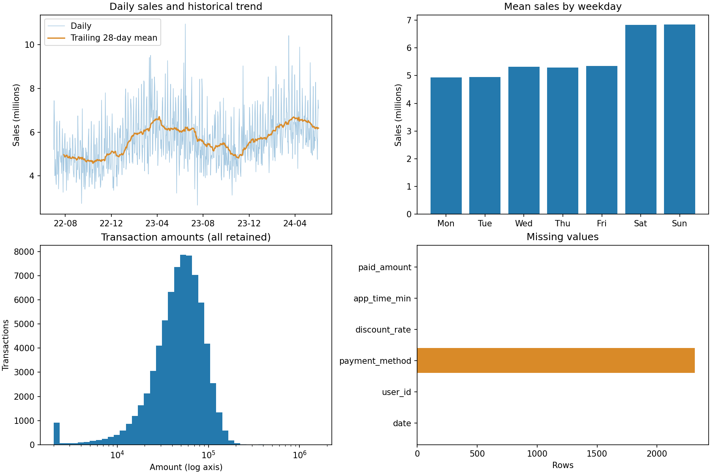
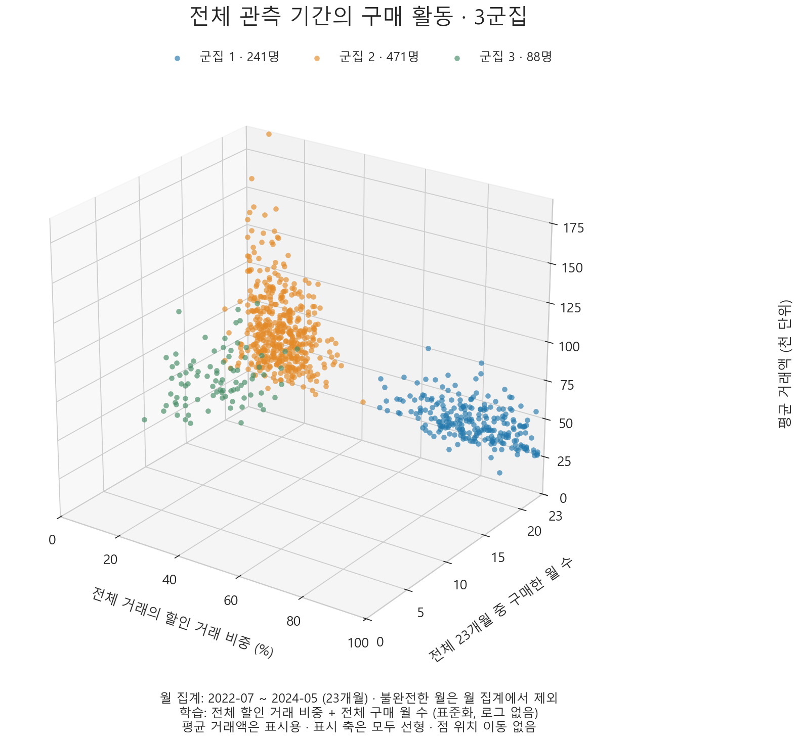
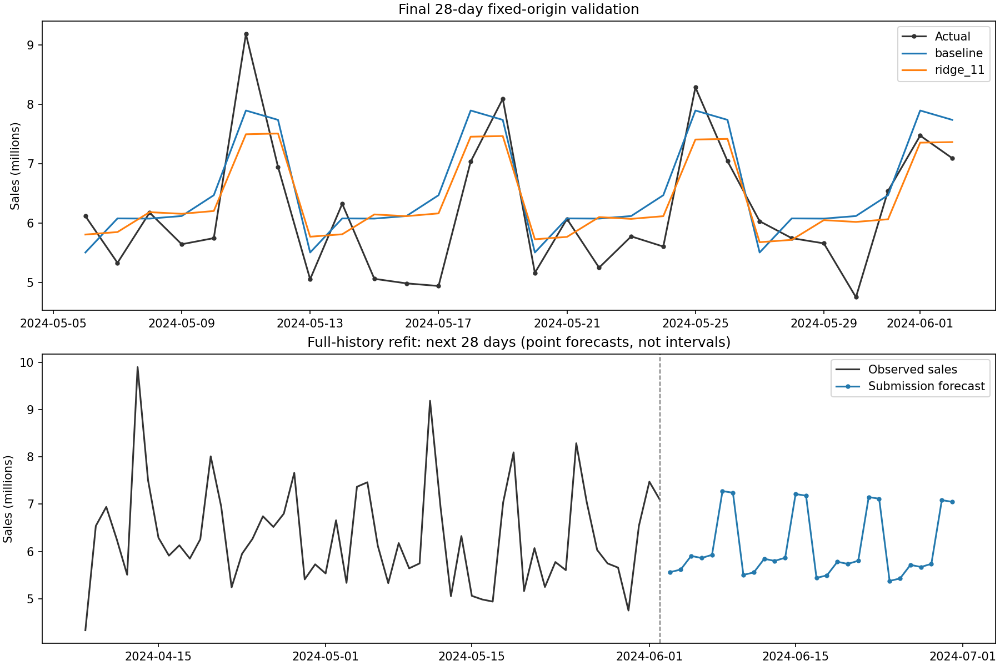

# 과제 2. 고객 세분화와 일별 매출 예측

## 요약

거래 72,573건, 고객 800명의 행동을 분석했다. 할인 거래 비중과 완전 관측 월의 구매 활동을 표준화해 k=3를 선택했다(실루엣 0.7382). 할인 활용 지속 구매층, 저할인 지속 구매층, 구매 활동 감소층으로 해석하고 서로 다른 처치를 실험 가설로 제시한다.

요일·연간 계절성·추세를 반영한 Ridge의 마지막 28일 MAPE는 9.944%로 공식 베이스라인 10.728%보다 낮았다. 설정을 바꾸지 않고 전체 703일로 재학습한 다음 28일 예측을 제출한다. 미래 실제값은 제공되지 않아 제출 구간 성능은 알 수 없다.

## 0. 데이터 이해와 전처리

| 변수 | 정의 |
|---|---|
| `date` | 거래가 발생한 날짜 |
| `user_id` | 고객 인덱스 |
| `payment_method` | 결제 수단 |
| `discount_rate` | 할인 비율 |
| `app_time_min` | 거래까지 앱 이용 시간 |
| `paid_amount` | 결제액 |

이상치는 결제수단 결측 2,314건(3.19%)이 있었다.

그림 1. 일매출과 과거 28일 이동평균, 요일별 평균, 거래액 분포, 결측 수. 로그 축은 분포 표시용이다. 이동평균은 탐색용이며 예측 입력으로 사용하지 않았다.

전체 이력의 주말 평균 매출은 평일의 1.323배다. 요일 패턴을 기본으로 반영하고 연간 계절성과 추세는 시간 순서를 지킨 검증으로 평가했다. 두 번의 완전한 연간 주기가 없어 반복성의 추정에는 한계가 있다. [데이터 점검 수치](sourcecode/evaluation/data_audit.json)

## 1. 고객 세분화

### 파생 변수

고객별 거래 이력을 집계하여 군집 학습에 사용할 파생변수 두 개를 생성하였다. 각각 고객의 할인 이용 성향과 여러 달에 걸친 구매 활동을 나타낸다.

**1. 할인 거래 비중 (`discount_usage_fraction`)**

고객의 전체 거래 중 할인율이 0보다 큰 거래의 비율이다. 고객별로 `discount_rate > 0`인 거래 수를 전체 거래 수로 나누어 계산하였다. 예를 들어 거래 100건 중 할인 거래가 80건이면 값은 0.8이며, 그래프에서는 80%로 표시한다. 전체 관측 기간인 2022년 7월 1일부터 2024년 6월 2일까지의 거래를 사용하였다.

값이 클수록 할인 혜택을 이용한 구매가 많다는 뜻이다. 평균 할인율과는 달리 할인 폭이 아니라 할인 사용의 빈도를 측정한다. 다만 할인 때문에 구매가 증가했는지는 알 수 없으므로, 인과적인 가격 민감도가 아닌 관측된 할인 이용 성향으로 해석하였다.

**2. 구매 월 수 (`active_months_full`)**

고객이 한 번 이상 구매한 월의 개수다. 완전히 관측된 2022년 7월부터 2024년 5월까지의 23개월을 대상으로, 각 월의 구매 여부를 0 또는 1로 표시한 뒤 합산하였다. 같은 달에 여러 번 구매해도 해당 월은 한 번만 센다. 예를 들어 23개월 중 14개월에 구매했다면 값은 14다.

값이 클수록 여러 달에 걸쳐 구매 활동이 나타난 고객이다. 거래 횟수가 같더라도 한 달에 집중적으로 구매한 고객과 여러 달에 걸쳐 구매한 고객을 구분할 수 있다. 2024년 6월은 이틀만 관측되어 이 변수의 계산에서 제외하였다. 구매 월 수는 구매 활동의 범위를 나타내며 일정한 구매 간격이나 계절성을 직접 뜻하지는 않는다.

할인 거래 비중은 0~1, 구매 월 수는 최대 23으로 척도가 다르므로 두 변수를 `StandardScaler`로 각각 평균 0, 분산 1이 되도록 표준화한 뒤 군집화에 사용하였다. 로그 변환은 적용하지 않았다. 총구매액·거래 건수·평균 거래액·최근성은 별도로 집계한 해석용 지표이며 군집 학습 입력에는 포함하지 않았다. 3D 그래프의 세 번째 축인 평균 거래액도 시각화용이다.

### 군집 수 선정

위 두 파생변수를 표준화한 값을 K-means(random_state=42, n_init=30)에 입력했다. 동일 입력에서 k=2~5를 비교해 실루엣 최대값으로 선택하고 Davies–Bouldin 지수도 확인했다.

| k | 실루엣 ↑ | Davies–Bouldin ↓ |
| --- | --- | --- |
| 2 | 0.6152 | 0.5774 |
| 3 | 0.7382 | 0.3818 |
| 4 | 0.7084 | 0.4764 |
| 5 | 0.6229 | 0.6367 |

총구매액·거래 건수·평균 거래액·최근성도 생성하되 해석에 사용한다. 총구매액은 거래 건수와 평균 거래액의 곱이라 모두 입력하면 규모를 중복 강조할 수 있다. 최근성과 구매 월 수 역시 활동을 중복 강조할 수 있어 최종 입력을 두 축으로 단순화했다. 이것이 모든 사업 목적에서 최적인 선택이라는 뜻은 아니다.

최근성은 마지막 관측일에서 고객의 마지막 구매일까지의 일수다. 구매 월 수는 활동 범위이며 일정한 구매 간격·개인별 계절성을 직접 측정하지 않는다. 가입일이 없어 관측 기회 차이를 완전히 보정할 수도 없다.

그림 2. 할인 거래 비중, 전체 23개월 중 구매 월 수, 평균 거래액을 세 축으로 표현한 고객 군집이다. 파랑·주황·초록은 각각 군집 1·2·3이다. 할인 거래 비중과 구매 월 수만 군집 학습에 사용했으며, 평균 거래액은 군집별 구매 규모를 함께 살펴보기 위한 표시용 축이다. 평균 거래액은 천 단위로 표시했고, 모든 축은 선형이며 점 위치를 임의로 이동하지 않았다.

### 비즈니스 프로필

| 군집 / 비즈니스 명칭 | 고객 수 | 할인 비중 | 구매 월 수 | 거래 건수 | 최근성(일) | 평균 거래액 | 매출 비중 |
| --- | --- | --- | --- | --- | --- | --- | --- |
| 1: 가격 민감 | 241 | 77.6% | 23 | 97 | 3.0 | 33,832 | 21.22% |
| 2: 가격 둔감 | 471 | 12.2% | 23 | 91 | 4.0 | 58,199 | 72.88% |
| 3: 간헐적 유저 | 88 | 12.5% | 14 | 48 | 113.5 | 53,448 | 5.90% |

고객 수·매출 비중을 제외한 표의 값은 고객별 지표의 군집 내 중앙값이다. 평균 거래액 열도 고객별 평균의 중앙값이며 군집 전체 거래 평균과 다르다. 매출 비중은 전체 관측 기간의 합계 기준이다.

**군집 1: 가격 민감** 할인 거래가 빈번하고, 지속적으로 구매한다.

**군집 2: 가격 둔감** 할인 이용은 적고 지속적으로 구매한다. 

**군집 3: 간헐적 유저.** 할인 이용이 적고 구매 월 수가 적다.

높은 실루엣은 입력 공간의 분리를 뜻하며 사업 효과를 입증하지 않는다. 군집은 현재 행동의 요약이고 미래 반응은 실험으로 확인해야 한다. [고객별 특성](sourcecode/evaluation/customer_features.csv), [군집 평가](sourcecode/evaluation/cluster_selection.csv)

## 3. 매출 예측

### 학습과 검증

| 구간 | 학습 종료일 | 다음 28일 평가 기간 |
| --- | --- | --- |
| selection_1 | 2024-01-14 | 2024-01-15~2024-02-11 |
| selection_2 | 2024-02-11 | 2024-02-12~2024-03-10 |
| selection_3 | 2024-03-10 | 2024-03-11~2024-04-07 |
| selection_4 | 2024-04-07 | 2024-04-08~2024-05-05 |
| final | 2024-05-05 | 2024-05-06~2024-06-02 |

각 원점 이전의 전체 이력만 모델에 전달하고 다음 28일을 한 번에 예측한다. 도중에 실제값을 입력하거나 모델을 갱신하지 않는다. 표준화·최근 가중치도 학습 구간에서만 계산한다. 미래 입력은 날짜로 계산 가능한 값뿐이다. 공식 베이스라인은 원점을 포함한 마지막 56일의 요일별 산술평균으로 요일당 정확히 8개 관측을 사용한다.

제출 모델의 특성은 요일 더미 7개, 선형 추세, 주기 365.2425일의 Fourier 1쌍이다. 가중 StandardScaler와 Ridge(alpha=100)를 사용한다. 최근 가중치는 2^(-경과일수/365)이며 평균 1로 정규화한다. 음수 예측은 0으로 절단하고 검증·제출에 동일 적용한다.

기존 탐색에서는 추세 포함 직접 회귀·지수평활·거래 건수×객단가를 비교했다. 적격 최저 평균 MAPE에서 0.05%p 이내면 단순한 직접 회귀를 우선해 설정을 고정했다. 허용폭은 결과를 본 뒤 정한 기준이며 통계적 동등성을 뜻하지 않는다. 추세 없는 대조군의 MAPE가 더 낮았으나 과제의 추세 요구를 보수적으로 적용했다. 현재 실행은 고정 설정과 공식 베이스라인의 평가를 재현하며 전체 후보를 재탐색하지 않는다.

### 성능과 한계

| 모델 | 선택용 평균 MAPE | 마지막 28일 MAPE | 마지막 MAE | 총매출 편향 |
| --- | --- | --- | --- | --- |
| baseline | 9.544% | 10.728% | 628,203 | +6.010% |
| ridge_11 | 8.938% | 9.944% | 588,046 | +3.389% |

MAPE=mean(|예측−실제|/실제)×100, MAE=mean(|예측−실제|)다. 총매출 편향은 (예측 합계−실제 합계)/실제 합계×100이며 양수면 과대예측이다. 일별 오차 상쇄를 고려해 총액과 일별 지표를 함께 본다.

마지막 구간에서 MAPE는 0.785%p, 상대적으로 7.31% 감소했다. 이는 모든 날짜·주차에서 개선됐다는 뜻이 아니다. 한 번의 28일 평가이며 독립적인 통계적 우월성이나 향후 성능을 보장하지 않는다.

그림 3. 위는 마지막 28일의 실제값·공식 베이스라인·고정 모델 비교, 아래는 전체 이력 재학습 이후의 28일 점예측이다. 실제값과 제출 예측 사이 점선이 원점이다. 예측 범위의 최소·최대는 신뢰구간이 아니다.

전체 703일로 재학습한 2024-06-03~2024-06-30 예측 합계는 170,925,959.18, 일별 최소·최대는 5,375,950.07~7,275,210.29다. [구간별 점수](sourcecode/evaluation/forecast_scores.csv), [예측 성분](sourcecode/evaluation/forecast_components.csv)

## 4. 비즈니스 액션 플랜 — 1페이지 요약

**전략: 군집별 구매 알림으로 추가 매출을 검증한다.** 모든 고객에게 같은 할인 메시지를 보내기보다, 구매가 뜸한 고객에게는 재방문을, 지속 구매 고객에게는 재구매를 유도한다. ‘가격 민감·둔감’은 할인 이용 행동에 붙인 명칭이며 실제 가격 반응은 검증되지 않았다. 매출의 72.88%를 차지하는 군집 2를 우선 검증 대상으로 삼고 나머지는 탐색적으로 평가한다.

| 대상과 관찰 근거 | 실행할 처치와 가설 | 확인할 행동 변화 |
|---|---|---|
| 군집 3 · 간헐적 유저 88명: 최근성 중앙값 113.5일 | 할인 없이 서비스 재방문 안내와 구매 페이지 바로가기를 1회 제공하면 구매를 재개하는가 | 28일 내 재구매 고객 비율 |
| 군집 2 · 가격 둔감층 471명: 구매 월 수 중앙값 23개월, 할인 비중 12.2% | 추가 할인 없이 재구매 안내와 구매 페이지 바로가기를 1회 제공하면 거래가 늘어나는가 | 고객당 거래 건수와 결제액 |
| 군집 1 · 가격 민감층 241명: 할인 비중 77.6%, 구매 월 수 23개월 | 기존 할인행사의 혜택·종료일을 1회 안내하면 행사 인지로 추가 구매가 발생하는가 | 고객당 결제액과 거래 건수 |

**예측을 활용한 집행.** 28일 매출 점예측은 합계 170.93백만이며 요일별 평균은 평일 5.47~5.83백만, 주말 7.14~7.18백만이다. 주말의 운영 부담을 고려해 첫 주 월·화 중 예측 매출이 낮은 날에 발송하고, 발송 시각·대상·문구는 실험 전에 고정한다. 할인 안내는 실제 행사 기간과 겹칠 때만 집행한다. 이는 운영 부하를 분산하기 위한 일정 선택이며, 낮은 예측 매출이 높은 마케팅 효과를 뜻하지는 않는다.

**검증 설계.** 발송 동의 고객을 군집별로 알림군·대조군에 1:1 무작위 배정한다. 대조군에는 이번 알림을 보내지 않으며 기존 혜택과 다른 운영 조건은 동일하게 유지한다. 군집 1의 대조군도 같은 할인행사를 이용할 수 있게 하여 알림의 추가 효과를 측정한다. 발송 후 28일 동안 미구매 고객을 0으로 포함한 전체 배정 고객을 분석하며 클릭·쿠폰 사용 고객만 골라 비교하지 않는다. 예측 대비 실제 매출의 차이를 캠페인 효과로 해석하지 않는다.

**성공 기준.** 공통 1차 지표는 ‘알림군의 고객당 28일 순결제액 − 대조군의 고객당 28일 순결제액’이며 순결제액은 환불을 차감한다. 표의 행동 지표는 효과를 해석하는 보조 지표다. 군집 2에서 증분 매출의 95% 신뢰구간 하한이 0을 넘고, 원가·발송비를 반영한 증분 공헌이익이 양수일 때 확대한다. 필요한 표본수는 과거 고객별 28일 매출 분산과 최소 기대효과로 사전 산정한다. 특히 88명인 군집 3은 검정력이 부족할 수 있어 결과가 불명확하면 효과 없음으로 단정하지 않고 후속 모집으로 확인한다.

**리스크 가드레일.** 고객당 발송은 28일 내 1회로 제한하고 중복 캠페인을 통제한다. 수신거부·민원이 대조군보다 증가하면 확대를 보류하며, 예산 상한 도달이나 발송 동의 위반 시 중단한다. 추가 할인은 지급하지 않고 기존 할인은 결제액에 이미 반영되므로 비용에서 중복 차감하지 않는다. 후속 28일도 관찰해 구매 시점을 앞당긴 효과인지 점검한다. 배정·발송·환불·원가·수신거부 기록은 현재 거래 데이터에 없으므로 실험 전에 수집 체계를 마련한다.

## 5. 재현과 제출 파일

`sourcecode/`에서 `python main.py`를 실행하면 준비된 `sourcecode/.venv`를 사용해 전처리, 모델링, 평가를 수행하고 두 제출 CSV·평가표·그림을 생성한다. Windows에서 현재 WSL 경로의 프로젝트를 실행해도 같은 WSL 가상환경을 사용한다. 실행 중 환경 설치나 ZIP 압축, 보고서 생성은 하지 않는다. 두 보고서는 별도 문서이며 실행 시 읽거나 수정하지 않는다.

입력은 `sourcecode/data/`와 `sourcecode/config/model.json`, 코드는 `sourcecode/main.py`와 `sourcecode/src/`, 의존성 명세는 `sourcecode/requirements.txt`다. 기본 출력은 `sourcecode`의 상위 제출 폴더이며 평가표는 `sourcecode/evaluation/`에 저장한다. 기존 보고서·그림·평가표를 입력으로 읽지 않는다. `--output-dir`로 출력 위치를 변경할 수 있다. 본 보고서는 분석 결과를 바탕으로 작성한 별도 문서이며, 비즈니스 제안은 검증된 실험 성과가 아니다. 다른 OS·경로에서는 가상환경을 Python 3.12와 의존성 명세로 다시 준비해야 할 수 있다.

- [submission_segments.csv](submission_segments.csv): `user_id,segment`, 고객 800명.
- [submission_forecast.csv](submission_forecast.csv): `date,predicted_sales`, 대상 날짜 28일.
- [데이터·실행 점검](sourcecode/evaluation/data_audit.json): 입력 해시, 데이터 규모, 결측·이상치 수치.
